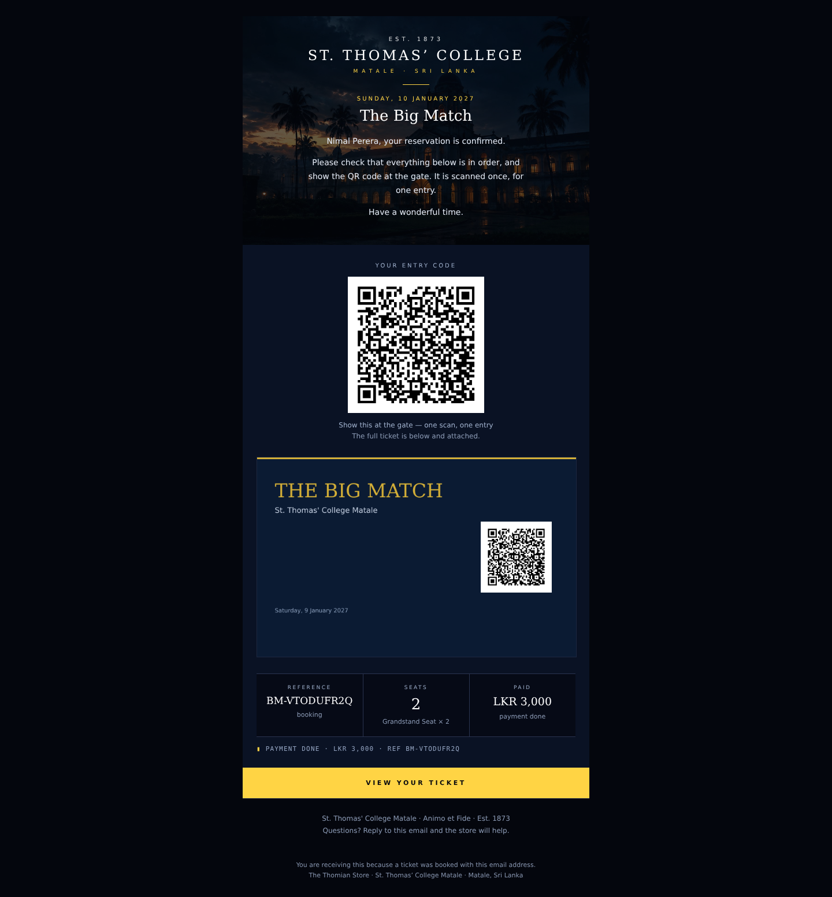

# Event tickets — how it works

Everything a ticket needs, from the design an admin uploads to the scan at the
gate. If you only read one section, read **Setting it up** below.

---

## 1. The shape of the flow

```
admin uploads a design            customer books                gate
with a white square      ──▶   ──▶ QR pasted in the    ──▶   ──▶ scan once
/admin/templates                  square, email sent           /admin/gate
                                  /t/<token> also shows it     (or /gate)
```

Every booking gets its own **admission ticket**:

- a **token** — 128 random bits, the secret that identifies the booking;
- a **signature** — an HMAC of that token, so a hand-typed reference is worthless;
- a **QR** holding `https://<site>/t/<token>/<signature>` (a short link — every
  character saved is a QR version saved);
- the **admin's design**, with the QR pasted into the white square.

Scanning the QR with any phone opens `/t/<token>/<signature>`, which shows the
booking and the seats. Nothing on that page admits anyone — admitting happens
only at `/admin/gate` (or `/gate`), behind the admin password, so a customer
cannot let themselves in by refreshing.

## 2. Setting it up

Copy `.env.example` to `.env.local` and fill in:

| Variable | Why |
| --- | --- |
| `TICKET_SECRET` | Signs every QR. `openssl rand -hex 32`. **Without it tickets can be forged.** |
| `ADMIN_PASSWORD` | The password for `/admin` and `/gate`. Empty = admin switched off. |
| `NEXT_PUBLIC_SITE_URL` | The real domain, so a scanned QR opens the right host. |
| `RESEND_API_KEY` *or* `SMTP_*` | How the ticket email leaves the building. |
| `MAIL_FROM` | The From: line. The domain must be verified with the provider. |

Then apply the database schema (`npm run db:migrate` against `DATABASE_URL`, or
the SQL in `db/schema.sql` through the Supabase SQL editor), sign in at
`/admin`, and upload a design.

### The design

Any image, any aspect ratio, PNG/JPEG/WebP up to 8 MB:

- Draw a **plain white square** where the QR belongs — solid `#ffffff`, nothing
  on top of it, equal width and height.
- That is the whole instruction. The app finds the square itself; there is no
  coordinate form to fill in.
- **How big?** The upload tells you if it is too small, and why. The rule is not
  a fixed pixel count: a QR needs about 5 pixels per module, so a 45-module code
  needs a ~230 px square *in the design's own pixels*, or at least ~18% of the
  design's shorter side. A 1440 px design with a 320 px square is comfortable;
  the same square in a 400 px image is not, because the design gets scaled down
  to fit an email.
- The QR is pasted using about **80%** of the square, so there is a small white
  margin around it — that margin is what makes the QR reliable when printed.
- The QR itself is a short link — `/t/<token>/<signature>` — because every
  character costs QR versions, and more versions means a bigger square.
- If the square cannot be found, the upload is refused and says why, instead of
  quietly producing tickets with no QR on them.

Uploads live in `public/uploads/templates/` (git-ignored). One design can be
tied to a single event, or left as the default for every event.

### The email

**One design, not a gallery.** Every customer gets the same mail: the event
photograph as the cover, the school's name on it, the date and the event, the
message, the ticket, a three-column details row and one wide button. There is no
"pick a design" step, because a school sending one kind of ticket does not need
one.

`/admin/mail` edits the words:

| Field | Where it lands |
| --- | --- |
| Subject | the line in the inbox |
| Heading | the big line over the photo (default `{{event}}`) |
| Message | between the heading and the ticket |
| Footer | small print under the button |

Any of `{{name}} {{event}} {{reference}} {{seats}} {{total}} {{venue}} {{date}}`
can be used in all four. Clearing a box restores the shipped default rather than
sending an empty message.

**The rest is not editable, on purpose.** Reference, seats, amount, date, venue
and the QR are the facts someone checks at the gate; letting them be typed by
hand would eventually put the wrong number in front of a customer.

The message, top to bottom:

1. **Cover** — the event photo under a flat navy wash, with `EST. 1873`,
   `ST. THOMAS' COLLEGE`, `MATALE · SRI LANKA`, a gold rule, the date, the event
   name and the message. Outlook ignores the photo and keeps the navy, so
   nothing depends on the photograph for contrast.
2. **Your entry code** — the QR at 220 px, drawn from the ticket's own link and
   embedded in the message (so it shows even when a mail client blocks remote
   images). A QR that is 18 % of a wide design is only about 100 px once the mail
   scales the artwork down; the close-up is what people actually scan.
3. **The ticket** — the admin's uploaded artwork at up to 552 px, with the QR in
   its white square. Also attached as a PNG, and the whole thing is a link.
4. **Reference · Seats · Paid** — three cells with hairline dividers, then a
   monospace line: `▮ PAYMENT DONE · LKR 3,500 · REF BM-ABC123`.
5. **One wide gold button** — to the ticket page.
6. **Footer** — the admin's small print, then the compliance line.

The preview on `/admin/mail` is the real message, not a mock-up: it is rendered
by `buildTicketMail()` — the same function that sends — inside an iframe, with
the inline QR swapped for its public URL. The same page can send a **test email**
to your own address, using a real booking, so the artwork and the QR are real
too. Do that before the first customer buys.

Resend is used when `RESEND_API_KEY` is set; otherwise plain SMTP. With neither,
bookings still succeed, the mail is logged to the server console, and the
confirmation screen says the ticket is below instead of claiming it was emailed.



### The admin is a separate app

`/admin` does not render inside the store. It has its own layout
(`app/admin/layout.tsx`), its own sidebar and its own palette — flat navy fills,
one gold accent, **no gradients and no glassmorphism anywhere** — and
`components/SiteChrome.tsx` bails out before drawing the navbar, footer, bag or
search overlay. The sidebar (below) carries the school crest at the top, the sections in
the middle (Overview, Bookings, Ticket designs, Ticket email, Gate scanner) and
the signed-in profile with sign-out at the bottom. Below `lg` it becomes a top
bar with a menu button. Every admin route is `noindex`. Screenshots of the
finished panel live in `docs/screens/`.

## 3. Selling and scanning

- Customers book on `/tickets`. The confirmation screen shows the same artwork
  that was emailed, with the same QR.
- At the gate, sign in and open `/admin/gate` (or `/gate`) on a phone. The camera uses the browser's
  `BarcodeDetector` where it exists; where it does not (iOS Safari, Firefox), the
  box takes a pasted link or a typed reference.
- **One admission per booking.** The first scan admits and records who scanned
  it; a second scan says *already admitted* and shows the original time, so a
  shared screenshot is obvious at the turnstile.
- A mis-scan can be undone from the gate screen; the ticket becomes valid again.
- A QR with a wrong signature is refused before the database is touched. A typed
  reference is accepted because only a signed-in admin can reach `/gate`.

`/admin/bookings` lists every booking: what was paid, whether it has been
scanned, and a **Resend** button that re-sends that customer's ticket.

## 4. Where the pieces live

| Path | What it does |
| --- | --- |
| `lib/tickets/detect.ts` | Finds the white square; composes the design + QR. |
| `lib/tickets/sign.ts` | Signs and checks the token; builds the QR URL. |
| `lib/tickets/templates.ts` | Upload, list, activate and delete designs. |
| `lib/tickets/email.ts` | The message HTML and the Resend/SMTP send. |
| `lib/tickets/mail-settings.ts` | The admin's saved wording, with defaults. |
| `lib/admin/auth.ts` | The password and the signed session cookie. |
| `lib/bookings.ts` | Booking, ticket lookup, admission, reopen. |
| `app/admin/layout.tsx` | The admin's own layout — the storefront chrome stays out. |
| `components/admin/AdminShell.tsx` | The sidebar, the mobile bar, the profile block. |
| `components/admin/ui.tsx` | The admin's flat-colour panels, fields, buttons and pills. |
| `app/admin/mail/preview` | The real mail, rendered for the iframe on `/admin/mail`. |
| `app/admin/` | Dashboard, designs, email editor, bookings, gate. |
| `app/gate/` | The volunteer's scanner. |
| `app/t/[token]/` | The page a customer's camera opens. |
| `app/api/tickets/[token]/image` | Renders the artwork; needs a valid signature. |
| `app/api/tickets/[token]/qr` | The QR alone, for the mail and its preview. |

## 5. If something is wrong

**"Email is not configured"** — set `RESEND_API_KEY` or the `SMTP_*` variables
and restart.

**"That design has no white square"** — the upload was refused on purpose. Check
it is a solid white square, not off-white or a photo of one.

**"The white square is only 83px … make it at least 230px"** — the message names
the size that design needs. Either enlarge the square in the artwork, or upload
the design at a larger pixel size. The percentage in the message is the one to
aim for if you would rather not think in pixels.

**A ticket says "not valid"** — the link was truncated, or `TICKET_SECRET`
changed after the ticket was issued. Changing the secret invalidates every
ticket already sent, so set it once and keep it. Tickets issued before the link
was shortened still work — both `/t/<token>?s=…` and `/t/<token>/<signature>`
are accepted.

**The gate says "invalid"** for a real ticket — the QR was scanned from a
screenshot that lost its signature. Paste the link, or type the reference.
