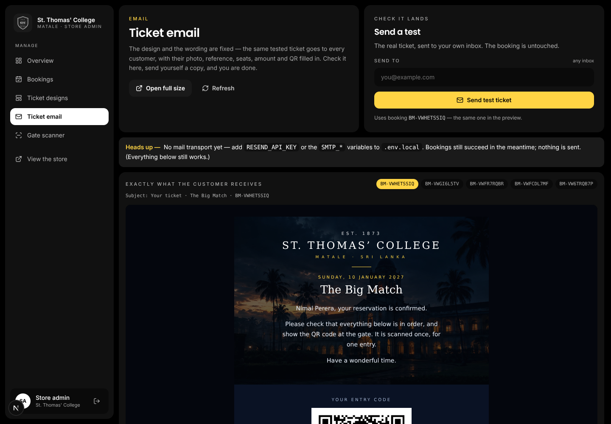
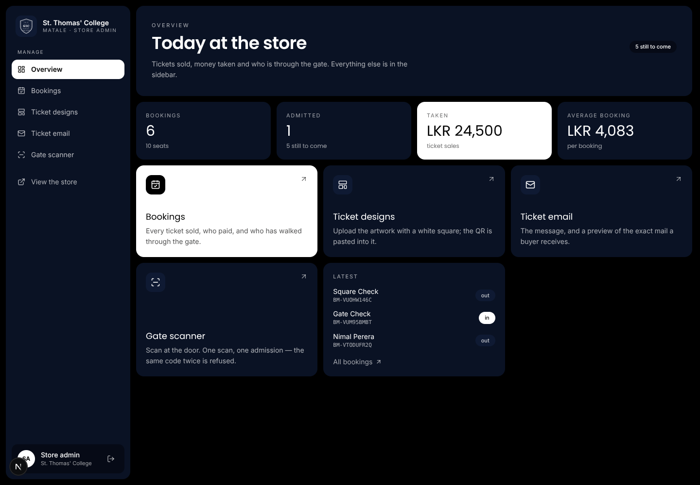

# Event tickets — how it works

Everything a ticket needs, from the design an admin uploads to the scan at the
gate. If you only read one section, read **Setting it up** below.

---

## 1. The shape of the flow

```
admin uploads a design            customer books                gate
with a white square      ──▶   ──▶ one email, a code  ──▶   ──▶ scan once each
/admin/templates                  per seat                     /admin/gate
/admin/settings                   /t/<token> also shows them   (or /gate)
(the school crest)
```

Every booking gets its own **admission ticket**:

- a **token** — 128 random bits, the secret that identifies the booking;
- a **signature** — an HMAC of that token, so a hand-typed reference is worthless;
- a **QR** holding `https://<site>/t/<token>/<signature>` (a short link — every
  character saved is a QR version saved);
- the **admin's design**, with the QR pasted into the white square.

Scanning the QR with any phone opens `/t/<token>/<signature>`, which shows the
booking and the seats. Nothing on that page admits anyone — admitting happens
only at `/admin/gate` (or `/gate`), behind the admin password, so a customer
cannot let themselves in by refreshing.

## 2. Setting it up

Copy `.env.example` to `.env.local` and fill in:

| Variable | Why |
| --- | --- |
| `TICKET_SECRET` | Signs every QR. `openssl rand -hex 32`. **Without it tickets can be forged.** |
| `ADMIN_PASSWORD` | The password for `/admin` and `/gate`. Empty = admin switched off. |
| `NEXT_PUBLIC_SITE_URL` | The real domain, so a scanned QR opens the right host. |
| `RESEND_API_KEY` *or* `SMTP_*` | How the ticket email leaves the building. |
| `MAIL_FROM` | The From: line. The domain must be verified with the provider. |

Then apply the database schema (`npm run db:migrate` against `DATABASE_URL`, or
the SQL in `db/schema.sql` through the Supabase SQL editor), sign in at
`/admin`, and upload a design.

### The design

Any image, any aspect ratio, PNG/JPEG/WebP up to 8 MB:

- Draw a **plain white square** where the QR belongs — solid `#ffffff`, nothing
  on top of it, equal width and height.
- That is the whole instruction. The app finds the square itself; there is no
  coordinate form to fill in.
- **How big?** The upload tells you if it is too small, and why. The rule is not
  a fixed pixel count: a QR needs about 5 pixels per module, so a 45-module code
  needs a ~230 px square *in the design's own pixels*, or at least ~18% of the
  design's shorter side. A 1440 px design with a 320 px square is comfortable;
  the same square in a 400 px image is not, because the design gets scaled down
  to fit an email.
- The QR is pasted using about **80%** of the square, so there is a small white
  margin around it — that margin is what makes the QR reliable when printed.
- The QR itself is a short link — `/t/<token>/<signature>` — because every
  character costs QR versions, and more versions means a bigger square.
- If the square cannot be found, the upload is refused and says why, instead of
  quietly producing tickets with no QR on them.

Uploads live in `public/uploads/templates/` (git-ignored). One design can be
tied to a single event, or left as the default for every event.

### The email

**One design, not a gallery.** Every customer gets the same mail: the crest in a
white circle, the event's photograph as the header, the date and event on a gold
band, the message, a three-column details row and one wide button. There is no "pick a
design" step, because a school sending one kind of ticket does not need one.

**One email per sale, one attached ticket per seat.** Buying four tickets sends
*one* message with **four attachments** — `BM-XXXX-ticket-1.png` to
`-ticket-4.png`, each the school's own uploaded design with that person's code
pasted into its white square. One file per person, not one per sale: a single
file for a ten-seat booking would leave nine people with nothing to show at the
gate, and forwarding a picture by hand is the thing nobody does.

The message body has no grid of codes. A wall of QR squares is not a ticket, and
the artwork already carries the code where the design put it; the body says how
many files are attached and points at them.

**The header is the event's photograph, with the crest and the school's name on
it — baked into one image.** Email has no way to put HTML text on top of a
picture. The header used to try: a CSS `background-image` on the cell with the
text over it. That is a background the client may not fetch and a stack of CSS
it may not honour, which is why the admin preview showed the photograph and the
inbox showed flat navy.

So `heroBanner()` in `lib/tickets/email.ts` does it in pixels instead. The photo
is read on the server, cropped to a 600 × 310 banner (1200 × 620 for retina),
washed into the navy, and the crest and the wordmark are composited onto it.
The mail carries the result as one ordinary `` on `cid:hero-banner` — part
of the message, so it arrives.

- The wash is baked in, fully opaque navy at the bottom edge, so the banner
  joins the gold tile below it with no seam, and dark enough under the name that
  the type reads at AA whatever the photograph is.
- `public/brand/masthead.png` is `ST. THOMAS' COLLEGE` over `MATALE · SRI LANKA`,
  rendered once from a serif at 2343 px wide. It is a picture of two lines of
  type rather than type itself because the name is drawn *into* an image, and no
  mail client renders SVG text; a fixed asset works the same on every server.
- No photograph, or a missing wordmark? `heroBanner()` returns null and the HTML
  masthead (crest in its circle, name, city) is drawn above a plain navy band
  instead. Plainer, never broken.

**The crest is inlined, not linked.** A remote `src` is a broken-image icon the
moment the reader's client cannot fetch it — the host has moved on, the file is
fine but not deployed yet, the client blocks remote images. The uploaded logo is
embedded as `cid:brand-logo`, sized by the **size in the circle** setting, so what
the admin sees in the preview is what arrives.

**Transparency is kept, and the circle is drawn behind the logo.** Uploads used
to be flattened onto white and padded on white, which put a square white plate
around a transparent crest — invisible on a white page, obvious against the navy
hero. The file now keeps its alpha and the white circle is a separate element
underneath, so the white is exactly the circle and nothing else. The version that
travels in the mail has its alpha thresholded to binary and is sent as GIF,
because Outlook and older Gmail composite PNG transparency onto the message
background.

`/admin/mail` does exactly two things: it **shows** the message and it **sends a
test**. There is no wording editor. The ticket is a default — subject, heading,
message and footer are the ones in `lib/tickets/email.ts` — because a ticket is
the one thing a school sends thousands of times and every variation of it is a
chance to ship a typo to a buyer. What the admin gets instead is certainty:

1. **Preview** — rendered by `buildBookingMail()`, the same function that sends,
   for a real booking, so the QR shown is the QR that will be scanned. Pick which
   booking to preview from the reference chips above the frame.
2. **Send a test** — type any address and the real ticket lands in that inbox.
   The same booking's artwork and QR, nothing changed on the booking. If no mail
   transport is configured the page says so in one line rather than failing
   silently.

The preview is bound to a real booking on purpose: the artwork and the QR are
per-booking, so a mocked-up one would prove nothing about what a customer sees.

**Nothing on the ticket is editable, on purpose.** Reference, seats, amount,
date, venue and the QR are the facts someone checks at the gate; letting them be
typed by hand would eventually put the wrong number in front of a customer.

The message, top to bottom:

1. **Header** — the crest and `ST. THOMAS' COLLEGE · MATALE · SRI LANKA` over
   the event's hero photograph, washed into the navy, inline.
2. **Gold band** — the date, the event name and (for a multi-seat sale) how many
   tickets are in the message.
3. **The message** — the admin's wording.
4. **Your tickets** — one panel saying how many files are attached. No grid of
   codes: the artwork carries the code, and one code per person travels as one
   attached PNG.
5. **Reference · Seats · Paid** — three cells with hairline dividers.
6. **One wide gold button** — to the ticket page.
7. **Footer** — the admin's small print, then the compliance line.

The preview on `/admin/mail` is the real message, not a mock-up: it is rendered
by `buildBookingMail()` — the same function that sends — inside an iframe, with
the inline parts (the baked header, and the crest when the masthead is drawn in
HTML) swapped for `data:` URIs so the frame shows the bytes that were actually
attached. The test send goes through the same
`sendTicketEmail()`, to the address the admin types instead of the buyer's.

Resend is used when `RESEND_API_KEY` is set; otherwise plain SMTP. With neither,
bookings still succeed, the mail is logged to the server console, and the
confirmation screen says the ticket is below instead of claiming it was emailed.




### The admin is a separate app

`/admin` does not render inside the store. It has its own layout
(`app/admin/layout.tsx`), its own sidebar and its own palette: **bento** — a tray
of rounded tiles where separation comes from the fill and the gap, **never from a
border** — and **black, white and yellow only**: a true near-black page, neutral
grey tiles stepping up from it, and the school's gold as the single accent (one
filled action per screen, one live state). No gradients, no glassmorphism, no
blur. State is carried by words and by that one accent, never by a red or green
the palette does not have. On a desktop the overview is one four-column grid:
hero and live list in row one, four equal stats in row two, four equal section
tiles in row three, so every cell starts and ends on the same line. And
`components/SiteChrome.tsx` bails out before drawing the navbar, footer, bag or
search overlay. The sidebar (below) carries the school crest at the top, the sections in
the middle (Overview, Bookings, Ticket designs, Ticket email, Gate scanner) and
the signed-in profile with sign-out at the bottom. Below `lg` it becomes a top
bar with a menu button. Every admin route is `noindex`. Screenshots of the
finished panel live in `docs/screens/` — `admin-overview.png`, `admin-bookings.png`,
`admin-templates.png`, `admin-mail.png`, `admin-gate.png`, `admin-mobile.png`.



## 3. Selling and scanning

- Customers book on `/tickets`. The confirmation screen shows the same artwork
  that was emailed, with the same QR.
- At the gate, sign in and open `/admin/gate` (or `/gate`) on a phone. The camera uses the browser's
  `BarcodeDetector` where it exists; where it does not (iOS Safari, Firefox), the
  box takes a pasted link or a typed reference.
- **One admission per ticket.** Each seat has its own code, so ten tickets admit
  ten people. The scan records who was admitted and when; scanning the same
  ticket again says *already admitted* and shows the original time, so a shared
  screenshot is obvious at the turnstile.
- A mis-scan can be undone from the gate screen; the ticket becomes valid again.
- A QR with a wrong signature is refused before the database is touched. A typed
  reference is accepted because only a signed-in admin can reach `/gate`.
- The customer's ticket page (`/t/<token>`) deliberately says **nothing** about
  whether the ticket has been scanned, and offers no bill: the person holding a
  photo of somebody else's QR must not be able to learn whether it is still good,
  and the receipt stays on the confirmation screen and in the admin.

### One code per ticket, and stopping one

A booking reference is shared by everybody in the party (`BM-ABC12345`), so it
cannot name the one QR that was forwarded to a stranger. Every ticket therefore
carries its own code — `BM-ABC12345-03` — printed on the bill, shown on the
ticket page, and returned by the gate.

`/admin/bookings/<reference>` is the page for one sale: every ticket in it, its
code, whether it has been used, and two buttons.

| Button | What it does | Use it when |
| --- | --- | --- |
| **Block** | The ticket stays on the sale and on the bill; the gate answers *blocked — do not admit*. Reversible. | A code was forwarded, a refund is being argued, somebody is barred. |
| **Delete** | The ticket is removed; its QR stops existing. The sale, its items and its total are untouched. | The ticket should never have existed — a double click, a seat typed twice. |

Blocking is the tool for a shared code: it leaves proof of what was sold and a
door that will not open. Deleting leaves nothing to explain.

### Issuing a ticket by hand

`/admin/bookings/new` creates a comp, a sponsor's seat or cash taken at the door:
pick the ticket type, a name, optionally an email, and a price (blank = the
tier's price, `0` = complimentary). It becomes an ordinary booking — its own
reference, one ticket, one code, the same QR, the same gate, the same bill — so
there is one kind of ticket in the building and not two.

`bookings.channel` records where a sale came from (`shop` or `counter`) and
`bookings.note` holds the line the paperwork always needs ("Comp — headmaster").

`/admin/bookings` lists every booking: what was paid, whether it has been
scanned, a **Resend** button that re-sends that customer's ticket, and a link to
the booking's own page.

## 4. Where the pieces live

| Path | What it does |
| --- | --- |
| `lib/tickets/detect.ts` | Finds the white square; composes the design + QR. |
| `lib/tickets/sign.ts` | Signs and checks the token; builds the QR URL. |
| `lib/tickets/templates.ts` | Upload, list, activate and delete designs. |
| `lib/tickets/email.ts` | The message HTML and the Resend/SMTP send. |
| `lib/tickets/mail-settings.ts` | The message wording and its shipped defaults. |
| `lib/admin/auth.ts` | The password and the signed session cookie. |
| `lib/db.ts` | Backend choice, pool, and the recorded failure the admin reports. |
| `lib/errors.ts` | Turning anything thrown — even an `AggregateError` with no message — into a sentence. |
| `lib/admin/db-guard.tsx` | What the admin is told when the database is not answering. |
| `lib/bookings.ts` | Booking, ticket lookup, admission, reopen, block/unblock, delete one ticket, issue one by hand. |
| `app/admin/layout.tsx` | The admin's own layout — the storefront chrome stays out. |
| `components/admin/AdminShell.tsx` | The sidebar, the mobile bar, the profile block. |
| `components/admin/ui.tsx` | The bento primitives: tiles, stat cells, fields, pills. |
| `app/admin/mail/preview` | The real mail, rendered for the iframe on `/admin/mail`. |
| `app/admin/` | Dashboard, designs, ticket email, bookings (list, one sale, issue), gate. |
| `app/gate/` | The volunteer's scanner. |
| `app/t/[token]/` | The page a customer's camera opens. |
| `app/api/tickets/[token]/image` | Renders the artwork; needs a valid signature. |
| `app/api/tickets/[token]/qr` | The QR alone, for the mail and its preview. |

## 5. If something is wrong

**The admin says "The database did not answer".** `DATABASE_URL` is set, but that
host is not reachable: Supabase paused, the project ref is wrong, the password was
rotated, or the pooler port is 6543 instead of 5432. The panel deliberately keeps
rendering — it reads nothing from the database, prints the reason at the top of
every admin page, and the shop falls back to its built-in catalogue. Check
`npm run db:check` against the same URL; it prints the connection error in plain
words.

**The admin says "DATABASE_URL is set but is not a usable Postgres URL".** The
variable has no host — a bare `postgres://`, or a password with an unencoded `@`
that swallowed the host. Percent-encode special characters (`@` → `%40`) and
restart.

Neither case takes a page down or kills the server process: a failed connection is
recorded once, reported in the panel, and not retried on every page load.

## 6. If something is wrong with an upload or an email

**"Email is not configured"** — set `RESEND_API_KEY` or the `SMTP_*` variables
and restart.

### Testing the email without a domain or a real inbox

Two things usually stop this: no verified domain yet, and not wanting to spray
test mail at the school's real address. Both are solvable.

**Prove it sends, on your own machine.** `npm run mail:trap` starts a tiny SMTP
server that prints what it receives. Point the app at it:

```bash
SMTP_HOST="127.0.0.1"
SMTP_PORT="1025"
SMTP_SECURE="0"
```

Then book a ticket, or use **Ticket email → Send a test**, and the trap prints
the recipient, the subject and the parts (`text/plain`, `text/html`, the inline
QR, the attached artwork) instead of the mail leaving your machine. It proves the
message is built and delivered over SMTP exactly as it will be for a customer,
with no domain and no inbox involved. It cannot prove deliverability — a real
provider's spam filtering is the one thing it cannot show.

**Prove it lands in a real inbox.** Either verify the domain you own (Resend →
Domains → add `machan.me`, add the DNS records it gives you, wait for
*Verified*), or use a Gmail account with an **App Password** — that needs no
domain at all:

```bash
SMTP_HOST="smtp.gmail.com"
SMTP_PORT="587"
SMTP_SECURE="0"
SMTP_USER="you@gmail.com"
SMTP_PASS="the 16-character app password"     # not your normal password
MAIL_FROM="The Thomian Store <you@gmail.com>"  # must match SMTP_USER
```

Google account → **Security** → 2-Step Verification → **App passwords**. Normal
passwords are refused by Gmail's SMTP, which is the most common reason "it does
not send".

**"Sell one ticket first"** used to block the test on a brand-new store, which is
backwards — the test is what you do *before* the first sale. With no bookings the
page now previews and sends a **sample** (`BM-SAMPLE`): a real event, a real
layout, a real QR, but not a live booking, so the gate will not admit it. The page
says so. Sell one ticket and it switches to your real booking automatically.

**"That design has no white square"** — the upload was refused on purpose. Check
it is a solid white square, not off-white or a photo of one.

**"The white square is only 83px … make it at least 230px"** — the message names
the size that design needs. Either enlarge the square in the artwork, or upload
the design at a larger pixel size. The percentage in the message is the one to
aim for if you would rather not think in pixels.

**A ticket says "not valid"** — the link was truncated, or `TICKET_SECRET`
changed after the ticket was issued. Changing the secret invalidates every
ticket already sent, so set it once and keep it. Tickets issued before the link
was shortened still work — both `/t/<token>?s=…` and `/t/<token>/<signature>`
are accepted.

**The gate says "invalid"** for a real ticket — the QR was scanned from a
screenshot that lost its signature. Paste the link, or type the reference.
